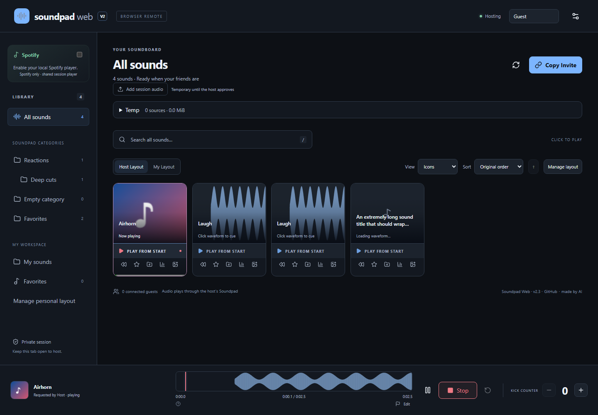
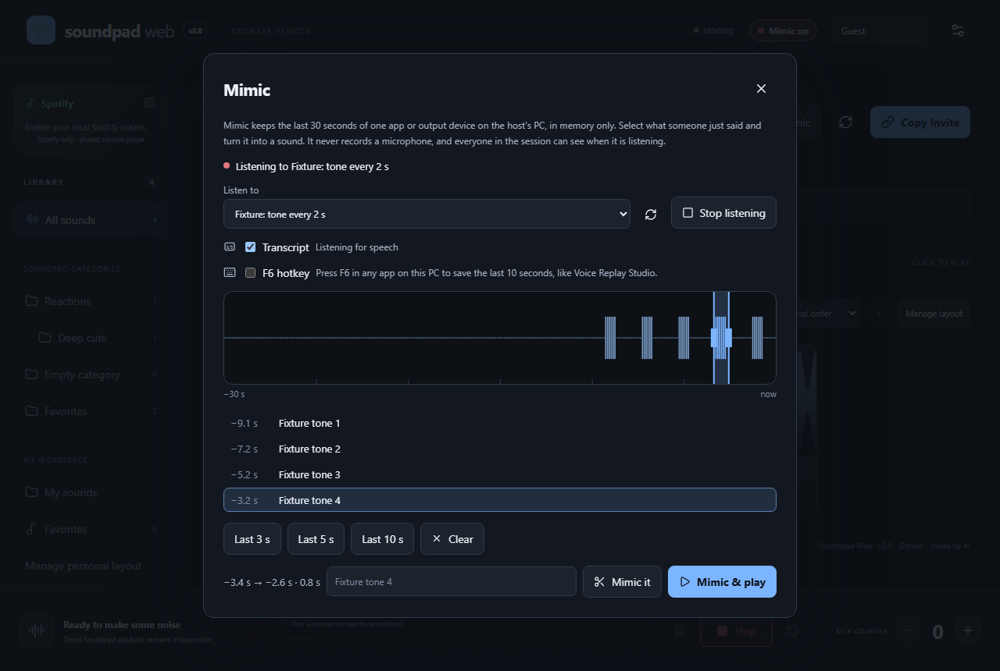

# Soundpad Web

A private browser remote for [Leppsoft Soundpad](https://www.leppsoft.com/soundpad/). Friends open your invite link, see your real Soundpad categories, tap a sound, and **your** Soundpad plays it through its current audio setup. With **Mimic**, your session can also grab something that was *just said* (in Discord, a game, anything playing on your PC) and turn it into a sound.

**[Open Soundpad Web](https://uh-oh-man.github.io/soundpad-web/)** · **[Download the Windows companion](https://github.com/uh-oh-man/soundpad-web/releases/latest/download/SoundpadWeb.exe)** · [What's new](CHANGELOG.md) · [Go back to an older version](docs/ROLLBACK.md)

> **made by AI.** Review the verification notes and known limitations before use. Versions up to 2.3.0 were written by OpenAI Codex. Claude Code led development from 2.3.1 through the overhaul. Codex resumed the overhaul in 2.46.0, working with [@uh-oh-man](https://github.com/uh-oh-man). Every change is recorded in the [changelog](CHANGELOG.md), and every release stays downloadable as a backup.

A static website plus one portable Windows program on the host PC. No accounts, no hosted backend, no cloud database. Guests install nothing.

## Host a session

1. Download **SoundpadWeb.exe** from the [latest release](https://github.com/uh-oh-man/soundpad-web/releases/latest). It requires Windows 11 x64, with no installer, administrator access or separate .NET.
2. Open Soundpad normally, then run the EXE. Since 2.36 it opens its own **Soundpad Web window**, which hosts your session: guests stay connected as long as that window is open, even minimized, and you need no browser tab.
3. Click **Copy Invite** and share the link. Each launch makes a fresh invitation; reloading the window keeps it.

You can still open the website in Chrome or Edge on the same PC as an extra view of your session (it shows the same guests and invite). Closing that tab does not affect guests. Closing the Soundpad Web window quits the companion and ends the session. If Windows lacks the WebView2 Runtime (it is part of Windows 11), the companion falls back to opening your browser as before; keep that tab open then. Since 2.44 the companion offers new versions itself (see [Updates](#updates)); you can still update by closing the old companion and running the new EXE.

## Try it first

Press **Try the example** on the [website](https://uh-oh-man.github.io/soundpad-web/) to try the soundboard, edited copies, Mimic's recording history with drafts, voices and sentences with example sounds, in your browser only. Nothing is sent to Soundpad and you need no companion for it. Controls that only work on the host's PC are marked **Host's PC only** and say why; leaving the example says what it clears.

## Join a session

Open the invite link in a modern browser (Chrome, Edge, Firefox or Safari, on a computer or phone) and pick a name. Tapping a sound plays it on the **host's** PC, not on your device.

Your browser keeps a private key for Soundpad Web, so the host knows it is you after a reload or a reconnect, and nobody can take your place by using your name. **Settings → Connection details → This browser** says whether that works in your browser (a private window may not keep it). The host sees **Unverified** next to a guest whose page is older than 2.41; reloading fixes it.

## Finding your way around

- **Sections.** **Soundboard**, **Mimic**, **Voices** and **Sentences** are listed in the sidebar, or as tabs along the top if you choose **Top tabs** in **Settings → Appearance → Navigation**. Voices and Sentences remember their tab, what you had open and where you had scrolled.
- **The editor panel.** The copy editor, a sound's editor and **Activity** open on the right, beside the board, which stays playable. Drag the panel's edge, or focus it and use the arrow keys, to change its width. On a phone the panel is a sheet: **Show board** folds it to a bar above the player, **Show editor** brings it back.
- **A sound's editor.** Every tile has **Open editor for …**, and the player has **Details for …**: the sound's waveform with cues and regions, effect and speed copies, its icon and its statistics. With companion 2.43 or newer, copies can start from any Soundpad sound; older companions make them from Temp audio only.
- **Tiles** say **Queued**, **Playing** or **Held**. Hover or focus a tile for quick **Reverse** and **Speed** (0.5× to 2×; the copy goes to Temp and plays when it is ready).
- **The player** sits at the bottom with **Stop** and **Panic** always in reach. **Kick** shows the lifetime count and, with companion 2.43, "+N this session"; **Kick counter details** has Decrease and Reset, and `+` and `-` work while Kick has the keyboard. **Spotify** is one row in the sidebar; **More Spotify controls** adds Previous and the progress. Guests' Spotify buttons control the host's Spotify, unless the host turns guest Spotify controls off.
- **Notices** appear in a strip under the board (above the player on a phone) and never cover a control. **Activity** keeps each one, with its **Undo** or **Jump**, for a minute after it goes.
- **The header ribbon** moves with the sound that is playing.
- **Settings → Appearance**: theme (**Blue studio**, **Original Purple** or **Ocean**), **Navigation**, **Motion** (System or Reduce), **Contrast** (Standard or High), **Header animation** (On, Still or Off) and **Notice sounds** (Off or Subtle). With companion 2.43, the host's browser and the companion window share the navigation, theme, motion, contrast, header animation and the open Mimic draft; guests keep their own choices.
- **Keyboard**: **Skip to sounds**, **Skip to player** and, with the editor open, **Skip to editor** appear on the first Tab.

## Mimic

The host chooses an app (for example Discord) or an output device. The companion keeps a rolling **recording history** on the host PC (10 minutes by default, deleted when it quits; companions before 2.39 kept 30 seconds in memory). Anyone allowed can then:

- open **Mimic**, look back through the history with word-by-word subtitles, and select a moment by dragging, clicking words, or **Latest phrase** / **Last 10 seconds**. The transcript follows the newest words; after scrolling back, **Jump to latest** (or End) returns to them. On a wide screen **Fill window** in Mimic's header lets it fill the window (the sections move to the top bar);
- **Capture** it as a draft of their own (since 2.40), adjust it, **Preview** it privately, **Play into game**, and **Keep in Temp** or **Keep in voice library**; guests allowed to keep clips can keep them too, within the budget the host sets;
- **Find words said in this recording** to jump to where something was said;
- from **Just mimicked**: replay, reverse, play with an effect (Chipmunk, Slow-mo, Echo, Slow same voice), or open the clip in **Edit copy** with one press. The host can also **Keep** a clip permanently from there, or **Undo** one made by mistake from its notice. **Delete** removes a clip (or the open draft) in one press, with **Undo** on the notice; guests can delete their own.

The host can also press a hotkey **in any app** to save the last few seconds mid-game: F6 by default, or F7–F10 if a game already uses F6. The waveform zooms to the last 30, 10 or 5 seconds for picking short moments. Mimic is off until the host starts it, never records a microphone, and everyone is told when it listens. Clips you saved in the Voice Replay Studio desktop app can be imported into the session from the Mimic window too. Full guide: [docs/MIMIC.md](docs/MIMIC.md).

## Voice library

**Voices** (beside **Mimic**, companion 2.41+) holds every clip you keep permanently, with the words said in it. Clips kept from Temp, from a Mimic draft, by a guest, or when the companion asks before quitting all go in; sounds kept earlier are added with **Add to voice library** in Temp. In it you can:

- search for a word or an exact phrase across your Soundpad sounds and voice clips, and click a word to hear exactly that word, privately (**Preview here**) or in the game (**Play into game**);
- give recordings a title, tags, a favourite star and a **voice** (who it sounds like), and correct their text; every change has **Undo**, and the library remembers who changed what;
- sort new recordings quickly in **Review**, from the keyboard (Space plays, 1–9 picks a voice, F favourites, Enter keeps, S skips);
- note **wanted words** for a voice, and get a quiet notice with **Jump** when Mimic hears one;
- (host) choose Soundpad categories in **Word index** to make their sounds searchable by their words. The companion transcribes them on your PC one file at a time, can pause, and only reads your files.

Guests can look, search and listen by default; changing the library needs the **Edit the voice library** permission (on by default, can be turned off per guest). Removing a recording from the library never deletes its file. **Group speakers (experimental)**, off by default, groups Mimic's phrases by who seems to speak so a person can name them.

## Sentences

**Sentences** (beside **Voices**, companion 2.42+) puts sentences together from words that were really said in your voice library's recordings. **Every word comes from a real recording**: nothing is synthesised, imitated or cloned. A word no recording has is never made up: it stays a **missing word**, marked in the text and on the timeline, and plays as a gap or a bleep, whichever you choose. Similar recorded words or a splice of two recorded words are offered for it, but used only when you pick one.

- **Type a sentence** and the recorded words appear on a timeline under the text; typing plays nothing. **Smooth to Chaotic** decides between long phrases in one voice and quick switches between voices, and the same settings always give the same result. **Swap take**, **Shuffle voices** and **Try contrasting deliveries** choose other recordings.
- **Shape it on the timeline**: drag pieces, set their edges, fades and volume, add pauses, apply effects, choose **Fluent joins** or **Original timing**, and try **Gentle cleanup**. Everything works from the keyboard too.
- **Preview here** plays it in your own browser; **Play into game** plays it through Soundpad like any sound, and Stop and Panic stop it.
- **Keep** saves it as a version that always sounds exactly as kept, even if its recordings change later. Kept sentences can be **pinned to the board** as tiles that play them into the game, and show up in Voices' search.
- **Palette**: tap recorded words and phrases, and named sounds like a laugh or a breath, to preview them or play them into the game. **Record performance** keeps a run of your own taps with their timing as a sentence you can edit.
- **Performance sets**: your own choice of voices, palette favourites and templates, kept for you by the companion.

Guests can read, search and preview sentences and play kept ones into the game. Building sentences follows **Edit the voice library**, keeping them follows **Keep clips** and the guest's Keep budget, and playing words or unkept sentences into the game also needs **Seeking & pause**. Unkept sentences are private to whoever made them. Full guide: [docs/SENTENCES.md](docs/SENTENCES.md).

## Organize your sounds

Press **Organize** on the board to tidy up without playing anything (companion 2.44 for the Host Layout; My Layout works with any companion). Tiles become checkboxes: click, Space or Enter ticks one, Shift-click ticks a range, Ctrl+A ticks every sound shown, and Esc leaves Organize mode. Then drag the selection onto a category in the sidebar, or use **Add selected to…** from the keyboard.

- **My Layout** changes at once, with **Undo**.
- **Host Layout** changes collect in **Review changes** in the editor panel. Each step says whether **Soundpad can do this** or you **do this in Soundpad**, and why. Only the host applies. Soundpad Web makes the changes Soundpad allows from outside (a new category, adding sounds to a category, removing an empty category), waits until nothing plays, checks every result and pauses instead of guessing if Soundpad changed meanwhile; you then **Skip**, **Retry**, **Rebind** or cancel. The rest (removing a sound from a category, moving, reordering, renaming) is listed as steps to do in Soundpad, and each is ticked off when Soundpad Web sees it done. After a plan that stopped partway, **Remove the empty categories this plan created** undoes what it added.
- **Guests** can propose steps when the host turns on **Guests may propose organization changes** in Settings (off by default), and withdraw their own proposals. They never see file paths.
- **Needs attention**: sounds whose file is missing on the host's PC are grouped at the end of their category with how to relink or remove them in Soundpad. They are not sent to Soundpad to play.
- **Copy into My Layout** from a guest's shared layout shows a preview first: choose folders, favourites, hidden sounds and order, and **Merge** (the default) or **Replace**, with Undo.

More: [docs/ORGANIZE.md](docs/ORGANIZE.md).

## Backups

**Settings → Backups** (host, companion 2.44) is off until you choose a folder: type one, or press **Use suggested folder** (`Documents\Soundpad Web Backups`). The companion then backs up your kept sounds, voice library, sentences, statistics, icons, settings and the window's and browser's layouts once a day and 10 minutes after a change, keeping the newest 14, everything from the last 30 days and one a week before that (all adjustable). Later backups only copy what changed. **Back up now** makes one at once.

Open a backup to restore a single kept clip, recording, voice or sentence, a layout, or the whole library. A **Before restore** backup is made first, and restored recordings, voices and sentences can be undone from the notice. A clip goes back only to where it was; a different file already there is reported, never overwritten. If Soundpad no longer lists a restored clip, you are told which file to add again in Soundpad: nothing is added to Soundpad by itself. Restoring the whole library asks first and needs playback stopped.

Backups contain your companion's identity, as its data folder does: keep the folder private and don't share it. If the companion ever says its local state is unreadable, the message tells you where the copy in your newest backup is; or close the companion and run `SoundpadWeb.exe --restore-state "<backup folder>"`. More: [docs/BACKUPS.md](docs/BACKUPS.md).

## Updates

When a newer Soundpad Web is released, the companion offers it at launch: **Update now**, **Later** or **What's new**. After **Later**, **Update** stays in the header and in Settings, where you can also **Check again** or turn off checking at launch. The update is downloaded from this project's GitHub releases and checked against the size and SHA-256 hash published with it; the EXE is not code-signed, so this proves it is the file that was published, not who built it.

Updating makes a backup first (if you set a backup folder), then the companion closes and opens again by itself and continues your session: Temp, drafts, history and the invitation stay, guests reconnect on their own, recording continues on the same output and the timeline marks the gap. Sounds already playing in Soundpad keep playing. If the new version doesn't start, the previous one comes back; it also stays beside the new one as `SoundpadWeb.previous.exe` (see [going back](docs/ROLLBACK.md)). Builds from a fork or a development checkout don't update themselves. More: [docs/UPDATES.md](docs/UPDATES.md).

## Setup and shortcuts

A new host on companion 2.44 is guided through setup: a Soundpad check that names the fix (Soundpad not running, not answering, started with different rights, or too old), the capture output to remember (only what the PC plays, never a microphone; nothing is recorded until you press **Start listening**), invitations and permissions, and shortcuts. An existing install gets a small **Check your setup** card instead. **Settings → Setup → Run setup again** reopens it. Soundpad Web never starts with Windows: open it from its EXE or a shortcut when you host. When Soundpad can't be reached, the banner at the top shows the same fix and **Retry**.

- **Settings → Keyboard** (everyone): change or turn off Search (`/`), Play/Pause (Space), Panic (Shift+Escape, host) and Stop (no key until you set one). Each browser keeps its own keys, so the companion window and Chrome can differ. Keys the browser or the app's own controls need are refused with the reason, and keys that only work in one place (Mimic, Review, Kick, the timeline) are listed.
- **Host-wide hotkeys** (Settings → Setup, host): a **Capture** key that starts or stops listening on the output you remembered, a **Panic** key and optionally **Stop playback**. They work in every app on your PC while the companion runs, and other apps can't use those keys meanwhile. All are off until you record one; a key another app already uses is reported and your previous key keeps working. Mimic's F6 key (save the last few seconds) is separate and can't be the same key.

More: [docs/SETUP.md](docs/SETUP.md).

## Feedback

Press **Feedback** in the header to send a **Bug**, an **Idea** or an **Opinion**. Guests can use it too. Every note is added, with who sent it and when, to one file on the host's desktop: **`Soundpad Web feedback.md`**. Guests are never shown where the file is. Needs the 2.45 companion on the host's PC.

## Features

- **Mimic**, described above, merged from the Voice Replay Studio desktop app.
- **Voice library**, described above: kept clips with their words, voices and tags, and word search that plays a single word.
- **Sentences and the speaking palette**, described above: sentences and performances made only from real recordings, kept as versions and pinned to the board.
- Real named-pipe Soundpad integration, including Steam and standalone distributions using the same RC API.
- Ordered, nested categories, native category icons, cross-category search, duplicate titles and empty categories.
- Play, prominent Stop, accurate vendor playback status and progress where available. When two people click at once, the newest click wins: older ones never play late and show no error.
- **Panic** (host): a separate button beside Stop, or **Shift+Escape** (you can change the key in **Settings → Keyboard**, or add a host-wide one in **Settings → Setup**). It stops the sound and pauses guest playback until you press **Resume guest playback**; the session, Mimic and Temp carry on.
- Up to 12 authorized guests per session, independent cryptographic host sessions, pinned host identity and invitation rotation.
- Host-controlled permissions for playback, the Kick counter, seeking, Spotify, uploads, reverse, Mimic, keeping clips and editing the voice library, for everyone or per guest; guests default to playback enabled and counter editing disabled.
- Authoritative persistent Kick counter with duplicate-request protection.
- Five personal views, real local waveform analysis, epoch-checked seeking, pause/resume, cues, regions and zoom.
- **Temp:** session uploads (with **Undo** on the notice if you picked the wrong file), reversed variants, trimmed or effect copies (including any speed from 0.05× to 20×, optionally keeping the pitch), and **Keep permanently** with host confirmation. **Edit copy** works like Voice Replay Studio's editor: drag on the waveform to choose the part, **Zoom to selection** for fine edges, and (host) **Preview** it with **Loop** before saving. **Save & play** makes the copy and plays it at once, and the host can **Undo** it from the notice that follows. With Mimic transcripts on, a plain trim is named after its own words. A search appears once Temp has more than six sources. **Remove** takes a clip off the list at once, also while something else plays, and with companion 2.46 the notice offers **Undo**; guests can remove their own clips, or all of them with **Remove all my Temp clips**. Everything temporary is removed from Soundpad and from disk when hosting ends, even if you close the companion window, or any time with **Clear all temporary audio**.
- Browser-personal nested layouts, favorites, hidden sounds and validated layout exports/imports.
- Named guests, durable web statistics and guarded read-only native Soundpad statistics.
- Large-photo PNG/JPEG cropping, dedicated 96-pixel icon storage, and safe V1 metadata migration.
- Optional shared Spotify desktop integration and End/Resume Hosting.
- Sidebar or top-tab sections, a resizable editor panel (a sheet on phones), mobile category selector, responsive sound grid and incremental rendering for large libraries.
- Three themes, high contrast and reduced motion settings, keyboard focus, skip links and shortcuts, and screen-reader labels checked by an automated accessibility test.

More screenshots: [Phone](docs/screenshots/v23-phone.png) · [Original Purple](docs/screenshots/v23-purple.png) · [Temp manager](docs/screenshots/v23-temp.png). They show the real interface with **fixture sounds**, not a real library.

## Access and privacy

Treat an invitation as a password. Anyone with it can join and use the permissions you enable. **Session & access → Replace invite** revokes the previous invitation and disconnects existing guests. Disconnecting one peer alone does not invalidate a bearer invitation; that person could return with a new browser identity.

Guests receive sound titles, category names/order/membership/icons, custom icons, playback status, counter and permissions, and (since 2.41) the voice library's titles, tags, voices and words, and (since 2.42) kept sentences, their versions and the palette, and (since 2.44) which sounds' files are missing and, when the host allows proposals, the organization plan's steps by name. Backups, updates, setup and host-wide hotkeys are never shown to guests. Host library audio is not sent to guests, except private previews of up to 30 seconds of voice-library recordings and of sounds in the categories the host indexes for word search, and private previews of sentences and palette words; they play in the guest's own browser and are never offered as a download. Guests never receive the host's file paths. Each guest's browser keeps its own private key, which never leaves it; the host's page checks it on every connection so permissions follow the right person. Guest uploads travel directly to the host; local paths, native access tokens and host signing keys stay local. Shared organization and enabled Spotify metadata/artwork are visible to session participants. There are no analytics, fonts or scripts loaded from other sites (the DM Sans typeface is part of the website), arbitrary file endpoints, shell commands or arbitrary Soundpad API access. Managed imports, and the Organize changes the host applies (a new category, adding a sound to a category, removing an empty category, each checked afterwards), are the only production library mutations; native entry removal is deliberately deferred when atomic ownership cannot be established, and Soundpad Web never removes a sound from a category or a category that still holds sounds. WebRTC exposes network connection information to peers; signaling relays see network metadata and encrypted session descriptions.

**Mimic** is off until the host starts it and never records a microphone. Everyone is told when it starts and stops, and a **Mimic on** badge shows while it listens. Its audio stays on the host PC: guests allowed to use Mimic receive waveform levels and, if the host turns transcripts on, the transcript text. Speech recognition runs locally. Guest Mimic is off by default. See [Mimic privacy](docs/MIMIC.md#privacy-and-safety).

## Troubleshooting

- **Waiting for Soundpad:** open Soundpad yourself. The companion retries automatically and refreshes the library every 30 seconds. You can also click Refresh. With companion 2.44 the banner says which problem it is (not running, not answering, started with different rights, too old) and has **Retry**; if Soundpad or Soundpad Web was started as administrator, start both the same way.
- **Companion disconnected:** keep the EXE running. Permit local-network access for this site if prompted, and use current Chrome/Edge. Another host tab may already own the connection. Do not disable browser security settings.
- **WebRTC blocked:** the guest's browser has WebRTC turned off or doesn't support it, often because of a privacy extension or setting. Allow WebRTC for the site, or use an up-to-date browser.
- **Host unavailable:** the host tab or companion may be closed, a laptop may be asleep, or signaling/WebRTC may be blocked. Check the invite and try another network. The app does not display Connected until the host's cryptographic handshake verifies.
- **Access revoked:** ask for the replacement invitation. If your tab missed revocation, an old invitation may instead wait for an unavailable host.
- **That sound is no longer in Soundpad:** it was removed or renamed in Soundpad. Refresh and choose it again. A sound that only moved plays at its new place.
- **Temp shows "copies of the Temp category with a garbled name":** companions before 2.15.9 sent Soundpad garbled category names and kept creating new Temp categories, so reverse and uploads never finished. Update the companion, open **Temp** and press **Remove duplicate categories**. Only empty categories carrying the app's tag are removed.
- **Temp says a native entry needs cleanup:** since 2.16 this only happens if something that isn't the app's own temporary audio is in its Temp category; the app then won't remove that category. Soundpad's API can only remove the selected entry, so the companion keeps that entry and its file. Remove only the indicated app-generated entry in Soundpad, **without deleting its file**, then press Retry cleanup. Cleanup never stops current playback, removes your categories or files, or deletes audio you kept permanently.
- **Hosting stops when the tab sleeps:** browser background throttling or a suspended mobile host tab can interrupt hosting. Keep the host tab open on a PC.

Connections use public relays to find each other, then encrypted peer-to-peer WebRTC. Restrictive networks can block that. Technical details are in [docs/DEVELOPERS.md](docs/DEVELOPERS.md#network-notes).

**Verification:** automated tests use isolated Soundpad fixtures and never trigger real audio. Real Soundpad audio playback remains an acceptance check; see [verification](docs/VERIFICATION.md).

## Going back to an older version

Every release stays on GitHub. Download any older `SoundpadWeb.exe` from [Releases](https://github.com/uh-oh-man/soundpad-web/releases); your saved data keeps working. Rolling back to the pre-Mimic v2.3.1, and mixing old and new website and companion versions, has been tested. Details: [docs/ROLLBACK.md](docs/ROLLBACK.md).

## What's in this repository

| Part | Where | What it does |
| --- | --- | --- |
| Website | `web/` | The static React site on GitHub Pages: soundboard, Temp, Mimic window, host settings. Guests only ever need this. |
| Windows companion | `companion/` | One portable `SoundpadWeb.exe` on the host PC. It talks to Soundpad, manages Temp audio, runs Mimic (capture, local Whisper transcript, the F6–F10 hotkey, preview, trim and effects) keeps the voice library and its word index, puts sentences together from its recordings, backs up and restores your data, updates itself and applies Organize plans to Soundpad. |
| Voice Replay Studio | `mimic/` | The original Mimic desktop app (V1.1), kept intact with its own [README](mimic/README.md), tests and licenses. |
| Docs | `docs/` | [Mimic](docs/MIMIC.md), [sentences](docs/SENTENCES.md), [Organize](docs/ORGANIZE.md), [backups](docs/BACKUPS.md), [updates](docs/UPDATES.md), [setup and shortcuts](docs/SETUP.md), [rolling back](docs/ROLLBACK.md), [developers](docs/DEVELOPERS.md), API research, protocol and verification notes. Version histories: [2.3](docs/V2.3.md), [V2](docs/V2.md). |

Building, testing, publishing your own fork, companion options and technical limitations: **[docs/DEVELOPERS.md](docs/DEVELOPERS.md)**. Maintainer notes: [CLAUDE.md](CLAUDE.md).

## License

[MIT](LICENSE). Soundpad is a separate proprietary product by Leppsoft; no Soundpad binary or user audio is included. [Third-party notices](THIRD-PARTY-NOTICES.md) describe the open-source dependencies and vendor reference attribution.
