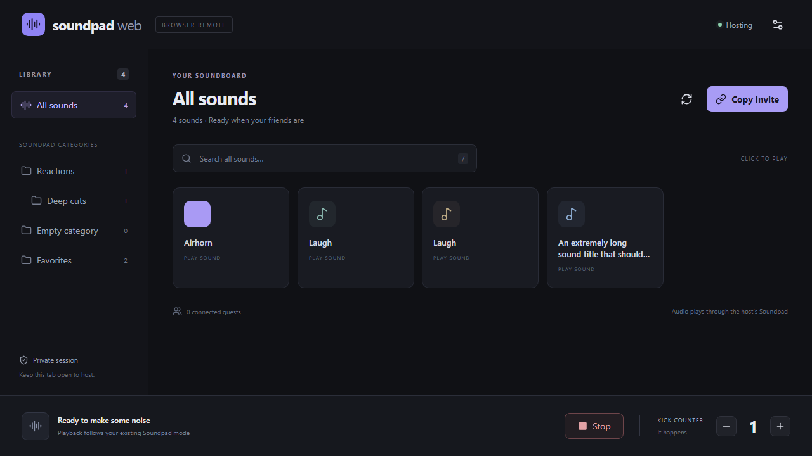

# Soundpad Web

A private browser remote for [Leppsoft Soundpad](https://www.leppsoft.com/soundpad/). Friends see your real categories, tap a sound, and your existing Soundpad plays it through its current audio setup.

Static React website + one portable Windows companion. No accounts, audio uploads, hosted application backend, or cloud database. Guests install nothing.

[Open Soundpad Web](https://uh-oh-man.github.io/soundpad-web/) · [Download the Windows companion](https://github.com/uh-oh-man/soundpad-web/releases/latest/download/SoundpadWeb.exe)

## Start a session

1. Download **SoundpadWeb.exe** from this repository's Releases. Before a tagged release exists, download the **SoundpadWeb-win-x64** artifact from a successful Windows Actions run and unzip it.
2. Open Soundpad normally, then run the EXE. Windows 11 x64 is required; no administrator access, installer, or separate .NET installation is needed.
3. The release EXE opens the project's website automatically. If you built an EXE without a configured website, paste your published HTTPS website URL on first launch; it is saved for future launches.
4. Click **Copy Invite** and share the link. Keep the companion window and host browser tab open.

Your friend opens the link in a modern browser. Playback starts on **your** PC, not their device. Allow the browser's local-network permission if it asks on the host. Start with current Chrome or Edge for hosting. Mobile guests do not use the loopback bridge.

**Verification:** automated tests use isolated Soundpad fixtures and never trigger real audio. Real Soundpad audio playback remains an acceptance check; see [verification](docs/VERIFICATION.md).

## Features

- Real named-pipe Soundpad integration, including Steam and standalone distributions using the same RC API.
- Ordered, nested categories, native category icons, cross-category search, duplicate titles and empty categories.
- Play, prominent Stop, accurate vendor playback status and progress where available.
- Up to 12 authorized guests per session, independent cryptographic host sessions, pinned host identity and invitation rotation.
- Host-controlled remote playback and guest counter permissions; guests default to playback enabled and counter editing disabled.
- Authoritative persistent Kick counter with duplicate-request protection.
- Optional per-sound PNG/JPEG icons, stored locally and synchronized to guests. Up to 256 custom icons, input at most 512 × 512 pixels / 128 KiB; normalized to 96 × 96 PNG.
- Desktop sidebar, mobile category selector, keyboard focus, responsive sound grid and incremental rendering for large libraries.

## Access and privacy

Treat an invitation as a password. Anyone with it can join and use the permissions you enable. **Session & access → Replace invite** revokes the previous invitation and disconnects existing guests. Disconnecting one peer alone does not invalidate a bearer invitation; that person could return with a new browser identity.

Guests receive sound titles, category names/order/membership/icons, custom icons, playback status, counter and permissions. Audio files, local paths, native access tokens and host signing keys stay local. There are no analytics, third-party fonts, arbitrary file endpoints, shell commands, recording, or Soundpad library-edit commands. WebRTC exposes network connection information to peers; signaling relays see network metadata and encrypted session descriptions.

## Screenshots

Actual application UI connected to the isolated test companion with **schema-derived fixture sounds**, not a real Soundpad library:



[Phone layout with fixture category](docs/screenshots/phone-fixture.png)

Counter, permissions, icons and an opaque-identity key live in `%LOCALAPPDATA%\SoundpadWeb\state.json`. Small settings are saved atomically; unreadable data stops startup instead of silently resetting your counter. Browser refresh retains the session within the same host tab. Restarting the EXE or ending the host tab starts a new invitation session. Other people's hosts have separate state and secrets.

## Connection problems

- **Waiting for Soundpad:** open Soundpad yourself. The companion retries automatically and refreshes the library every 30 seconds. You can also click Refresh.
- **Companion disconnected:** keep the EXE running. Permit local-network access for this site if prompted, and use current Chrome/Edge. Another host tab may already own the connection. Do not disable browser security settings.
- **Host unavailable:** the host tab or companion may be closed, a laptop may be asleep, or signaling/WebRTC may be blocked. Check the invite and try another network. The app does not display Connected until the host's cryptographic handshake verifies.
- **Access revoked:** ask for the replacement invitation. If your tab missed revocation, an old invitation may instead wait for an unavailable host.
- **Soundpad library changed:** click the sound again after refresh. Stale indexes are rejected to avoid playing a different sound.

Public [Nostr relays via Trystero](https://trystero.dev/) establish the connection; encrypted WebRTC carries commands/state. No application signaling server is deployed. Public relays are best effort, and restrictive NAT/firewalls may prevent direct WebRTC. No free universal TURN service is assumed. Advanced maintainers may configure their own TURN server at build time using `VITE_TURN_CONFIG` (JSON array of RTCIceServer entries). Anything embedded in a static bundle is public: never put confidential or long-lived third-party credentials there. Use credentials intended for public clients, or your own short-lived credential provisioning outside this project's normal setup.

## Publish your fork with GitHub Pages

1. Put this source in your GitHub repository and enable Actions.
2. In **Settings → Pages**, choose **GitHub Actions** as the build source.
3. Push to `main` or `master`, or run **GitHub Pages** manually. Its final deployment step reports your actual URL.
4. Download the Windows workflow artifact and launch the EXE. The workflow embeds the default project Pages URL. For a custom domain or user/organization Pages repository, set the repository variable `SOUNDPAD_WEB_URL` to the actual website URL before building, or override it with the companion's `--site` option.

The deployment workflow derives the correct repository base path from Pages configuration, including project pages and custom domains. Local builds use relative asset paths by default. Override `VITE_BASE_PATH` only when needed. Push a `v*` Git tag to build, test and publish an EXE release with a SHA-256 hash. Source builds may embed a default website using `dotnet publish ... -p:WebsiteUrl=https://your-site.example/`; the runtime `--site` override always remains available.

## Build from source

Developer requirements: Node.js 24, .NET 10 SDK, Windows for native tests/publishing. End users need neither Node nor the .NET SDK.

```powershell
npm ci
npm run lint
npm test
npm run build
dotnet test companion/tests/SoundpadWeb.Tests.csproj -c Release
dotnet build companion/harness/SoundpadWeb.Harness.csproj -c Release
npx playwright install chromium
npm run test:e2e
dotnet publish companion/SoundpadWeb.Companion.csproj -c Release -r win-x64 --self-contained true -o artifacts/release
```

`dist/` is the fully static website. `artifacts/release/SoundpadWeb.exe` is the standalone executable. The normal Windows workflow builds both and uploads them. Linux can build/test the frontend and publish Windows code with suitable targeting, but native pipe/image tests require Windows.

For development, run `npm run dev`, then:

```powershell
.\artifacts\release\SoundpadWeb.exe --dev --site http://127.0.0.1:5173/
```

This connects to real Soundpad if running. Routine browser tests instead launch a completely separate mock pipe via `companion/harness`; fixtures never ship in the EXE. Optional real Nostr/WebRTC browser integration tests: `$env:LIVE_RELAY='1'; npm run test:e2e -- --grep 'live Nostr'`. They still use a mock Soundpad, so no real audio plays. CI's default tests do not depend on public relay availability.

Advanced companion options: `--site <HTTPS URL>`, `--no-browser`, `--data-dir <local directory>`, `--pipe <test pipe name>`. `--dev` permits HTTP only for a loopback website. Close the companion with Ctrl+C. No LAN listener, firewall changes or system service is installed.

You can also press Enter in the companion window for a clean shutdown. Only one companion may use a given data directory at a time. `--licenses` prints embedded notices without starting a server. Native runtime dependencies are pinned to .NET / ASP.NET Core 10.0.13; update that patch and the bundled notices together when maintaining a fork. NuGet and npm lockfiles are checked in.

## Technical notes and limitations

See [vendor API research](docs/API-RESEARCH.md), [protocol/security design](shared/protocol/README.md), and [test evidence](docs/VERIFICATION.md).

Icons follow an HMAC of the vendor file URL and duplicate occurrence. Unique paths survive reordering; moving/renaming a file changes identity, and exact duplicate paths cannot be perfectly distinguished. Soundpad does not offer an atomic persistent-ID play command, leaving a narrow last-query/play reorder race. Now-playing titles are deliberately not guessed from the last browser click: manual Soundpad playback remains usable.

Browser background throttling or a suspended mobile host tab can interrupt hosting. The EXE does not independently maintain WebRTC when the host tab is closed. HTTPS-to-loopback policies vary by browser; passing local HTTP tests is not proof of GitHub Pages compatibility. The EXE is unsigned; this project does not install a certificate or modify your system trust settings.

## License

[MIT](LICENSE). Soundpad is a separate proprietary product by Leppsoft; no Soundpad binary or user audio is included. [Third-party notices](THIRD-PARTY-NOTICES.md) describe the open-source dependencies and vendor reference attribution.
