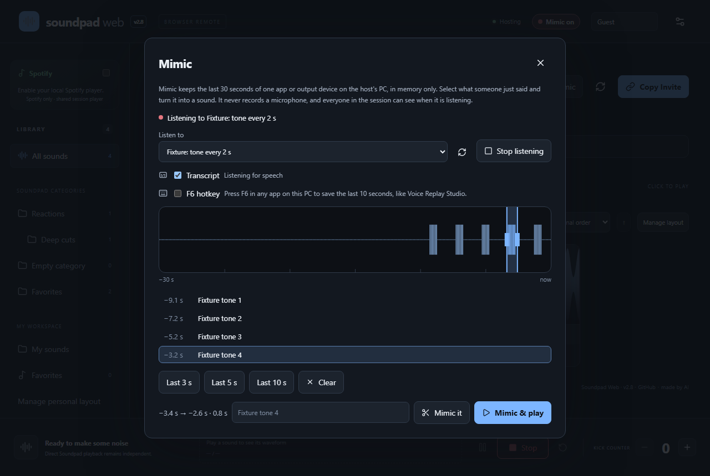

# Soundpad Web

A private browser remote for [Leppsoft Soundpad](https://www.leppsoft.com/soundpad/). Friends open your invite link, see your real Soundpad categories, tap a sound, and **your** Soundpad plays it through its current audio setup. With **Mimic**, your session can also grab something that was *just said* (in Discord, a game, anything playing on your PC) and turn it into a sound.

**[Open Soundpad Web](https://uh-oh-man.github.io/soundpad-web/)** · **[Download the Windows companion](https://github.com/uh-oh-man/soundpad-web/releases/latest/download/SoundpadWeb.exe)** · [What's new](CHANGELOG.md) · [Go back to an older version](docs/ROLLBACK.md)

> **made by AI.** Review the verification notes and known limitations before use. Versions up to 2.3.0 were written by OpenAI Codex. Since 2.3.1 the main editor is Claude (Anthropic's Claude Code), working with [@uh-oh-man](https://github.com/uh-oh-man). Every change is recorded in the [changelog](CHANGELOG.md), and every release stays downloadable as a backup.

A static website plus one portable Windows program on the host PC. No accounts, no hosted backend, no cloud database. Guests install nothing.

## Host a session

1. Download **SoundpadWeb.exe** from the [latest release](https://github.com/uh-oh-man/soundpad-web/releases/latest). It requires Windows 11 x64, with no installer, administrator access or separate .NET.
2. Open Soundpad normally, then run the EXE. It opens the website for you.
3. Click **Copy Invite** and share the link. Keep the companion window and your browser tab open while hosting.

Use current Chrome or Edge to host, and allow the browser's local-network permission if it asks. To update, close the old companion normally and run the new EXE; refresh the website.

## Join a session

Open the invite link in a modern browser, on a computer or phone, and pick a name. Tapping a sound plays it on the **host's** PC, not on your device.

## Mimic

The host chooses an app (for example Discord) or an output device. The companion keeps the last 30 seconds **in memory on the host PC**. Anyone allowed can then:

- open **Mimic**, see that audio as a live waveform with an optional transcript, and select a moment by dragging, clicking a transcript line, or pressing **3**, **5** or **0**;
- **Mimic it** to save it as a Temp sound, or **Mimic & play** it through Soundpad. The host can **Preview** it privately first;
- replay, reverse, trim or add an effect afterwards (Chipmunk, Slow-mo, Echo).

The host can also press **F6 in any app** to save the last few seconds mid-game. Mimic is off until the host starts it, never records a microphone, and everyone is told when it listens. Full guide: [docs/MIMIC.md](docs/MIMIC.md).

## Features

- **Mimic**, described above, merged from the Voice Replay Studio desktop app.
- Real named-pipe Soundpad integration, including Steam and standalone distributions using the same RC API.
- Ordered, nested categories, native category icons, cross-category search, duplicate titles and empty categories.
- Play, prominent Stop, accurate vendor playback status and progress where available.
- Up to 12 authorized guests per session, independent cryptographic host sessions, pinned host identity and invitation rotation.
- Host-controlled permissions for playback, the Kick counter, seeking, Spotify, uploads, reverse and Mimic; guests default to playback enabled and counter editing disabled.
- Authoritative persistent Kick counter with duplicate-request protection.
- Five personal views, real local waveform analysis, epoch-checked seeking, pause/resume, cues, regions and zoom.
- **Temp:** session uploads, reversed variants, trimmed or effect copies, and **Keep permanently** with host confirmation.
- Browser-personal nested layouts, favorites, hidden sounds and validated layout exports/imports.
- Named guests, durable web statistics and guarded read-only native Soundpad statistics.
- Large-photo PNG/JPEG cropping, dedicated 96-pixel icon storage, and safe V1 metadata migration.
- Optional shared Spotify desktop integration and End/Resume Hosting.
- Desktop sidebar, mobile category selector, responsive sound grid and incremental rendering for large libraries.
- Three themes, keyboard focus and shortcuts, and screen-reader labels checked by an automated accessibility test.

More screenshots: [Phone](docs/screenshots/v23-phone.png) · [Original Purple](docs/screenshots/v23-purple.png) · [Temp manager](docs/screenshots/v23-temp.png). They show the real interface with **fixture sounds**, not a real library.

## Access and privacy

Treat an invitation as a password. Anyone with it can join and use the permissions you enable. **Session & access → Replace invite** revokes the previous invitation and disconnects existing guests. Disconnecting one peer alone does not invalidate a bearer invitation; that person could return with a new browser identity.

Guests receive sound titles, category names/order/membership/icons, custom icons, playback status, counter and permissions. Host library audio is not sent to guests. Guest uploads travel directly to the host; local paths, native access tokens and host signing keys stay local. Shared organization and enabled Spotify metadata/artwork are visible to session participants. There are no analytics, third-party fonts, arbitrary file endpoints, shell commands or arbitrary Soundpad API access. Managed imports are the only production library mutations; native entry removal is deliberately deferred when atomic ownership cannot be established. WebRTC exposes network connection information to peers; signaling relays see network metadata and encrypted session descriptions.

**Mimic** is off until the host starts it and never records a microphone. Everyone is told when it starts and stops, and a **Mimic on** badge shows while it listens. Its audio stays on the host PC: guests allowed to use Mimic receive waveform levels and, if the host turns transcripts on, the transcript text. Speech recognition runs locally. Guest Mimic is off by default. See [Mimic privacy](docs/MIMIC.md#privacy-and-safety).

## Troubleshooting

- **Waiting for Soundpad:** open Soundpad yourself. The companion retries automatically and refreshes the library every 30 seconds. You can also click Refresh.
- **Companion disconnected:** keep the EXE running. Permit local-network access for this site if prompted, and use current Chrome/Edge. Another host tab may already own the connection. Do not disable browser security settings.
- **Host unavailable:** the host tab or companion may be closed, a laptop may be asleep, or signaling/WebRTC may be blocked. Check the invite and try another network. The app does not display Connected until the host's cryptographic handshake verifies.
- **Access revoked:** ask for the replacement invitation. If your tab missed revocation, an old invitation may instead wait for an unavailable host.
- **Soundpad library changed:** click the sound again after refresh. Stale indexes are rejected to avoid playing a different sound.
- **Temp says a native entry needs cleanup:** Soundpad's API cannot guarantee that another app or user will not change the selection between check and delete, so the companion keeps that entry and its file. Remove only the indicated app-generated entry in Soundpad, **without deleting its file**, then press Retry cleanup. Cleanup never stops current playback, removes your categories or files, or deletes audio you kept permanently.
- **Hosting stops when the tab sleeps:** browser background throttling or a suspended mobile host tab can interrupt hosting. Keep the host tab open on a PC.

Connections use public relays to find each other, then encrypted peer-to-peer WebRTC. Restrictive networks can block that. Technical details are in [docs/DEVELOPERS.md](docs/DEVELOPERS.md#network-notes).

**Verification:** automated tests use isolated Soundpad fixtures and never trigger real audio. Real Soundpad audio playback remains an acceptance check; see [verification](docs/VERIFICATION.md).

## Going back to an older version

Every release stays on GitHub. Download any older `SoundpadWeb.exe` from [Releases](https://github.com/uh-oh-man/soundpad-web/releases); your saved data keeps working. Rolling back to the pre-Mimic v2.3.1, and mixing old and new website and companion versions, has been tested. Details: [docs/ROLLBACK.md](docs/ROLLBACK.md).

## What's in this repository

| Part | Where | What it does |
| --- | --- | --- |
| Website | `web/` | The static React site on GitHub Pages: soundboard, Temp, Mimic window, host settings. Guests only ever need this. |
| Windows companion | `companion/` | One portable `SoundpadWeb.exe` on the host PC. It talks to Soundpad, manages Temp audio, and runs Mimic: capture, local Whisper transcript, F6, preview, trim and effects. |
| Voice Replay Studio | `mimic/` | The original Mimic desktop app (V1.1), kept intact with its own [README](mimic/README.md), tests and licenses. |
| Docs | `docs/` | [Mimic](docs/MIMIC.md), [rolling back](docs/ROLLBACK.md), [developers](docs/DEVELOPERS.md), API research, protocol and verification notes. Version histories: [2.3](docs/V2.3.md), [V2](docs/V2.md). |

Building, testing, publishing your own fork, companion options and technical limitations: **[docs/DEVELOPERS.md](docs/DEVELOPERS.md)**. Maintainer notes: [CLAUDE.md](CLAUDE.md).

## License

[MIT](LICENSE). Soundpad is a separate proprietary product by Leppsoft; no Soundpad binary or user audio is included. [Third-party notices](THIRD-PARTY-NOTICES.md) describe the open-source dependencies and vendor reference attribution.
