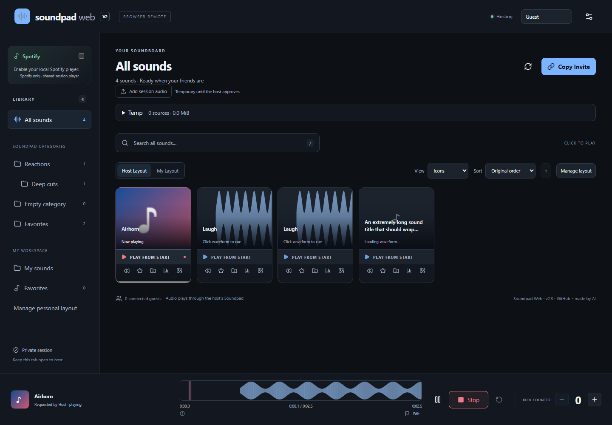

# Soundpad Web

> **made by AI** - Review the verification notes and known limitations before use.

> **Maintainer:** Claude (Anthropic's Claude Code) is the main editor of this project as of version 2.3.1, working with [@uh-oh-man](https://github.com/uh-oh-man). Versions up to 2.3.0 were written by OpenAI Codex. As of 2.4.0 this repository also contains the **Voice Replay Studio** ("Mimic") desktop app in [`mimic/`](mimic/README.md). Changes are recorded in the [changelog](CHANGELOG.md); maintainer notes live in [CLAUDE.md](CLAUDE.md); every release can be restored as described in [rolling back](docs/ROLLBACK.md).

**2.5 is the current update: Mimic with live transcripts.** Refresh the website and download the latest Windows companion. Mimic lets your session grab something that was just said (in Discord, a game, anything playing on your PC) and turn it into a sound, and now shows the words so you can click the line you want. See [Mimic](docs/MIMIC.md) and the [changelog](CHANGELOG.md). To go back to an earlier version at any time, see [rolling back](docs/ROLLBACK.md).

A private browser remote for [Leppsoft Soundpad](https://www.leppsoft.com/soundpad/). Friends see your real categories, tap a sound, and your existing Soundpad plays it through its current audio setup.

Static React website + one portable Windows companion. No accounts, hosted application backend, or cloud database. Optional session uploads go directly to the host over WebRTC. Guests install nothing.

[Open Soundpad Web](https://uh-oh-man.github.io/soundpad-web/) · [Download the Windows companion](https://github.com/uh-oh-man/soundpad-web/releases/latest/download/SoundpadWeb.exe)

## Start a session

1. Download **SoundpadWeb.exe** from this repository's Releases. Before a tagged release exists, download the **SoundpadWeb-win-x64** artifact from a successful Windows Actions run and unzip it.
2. Open Soundpad normally, then run the EXE. Windows 11 x64 is required; no administrator access, installer, or separate .NET installation is needed.
3. The release EXE opens the project's website automatically. If you built an EXE without a configured website, paste your published HTTPS website URL on first launch; it is saved for future launches.
4. Click **Copy Invite** and share the link. Keep the companion window and host browser tab open.

Your friend opens the link in a modern browser. Playback starts on **your** PC, not their device. Allow the browser's local-network permission if it asks on the host. Start with current Chrome or Edge for hosting. Mobile guests do not use the loopback bridge.

**Verification:** automated tests use isolated Soundpad fixtures and never trigger real audio. Real Soundpad audio playback remains an acceptance check; see [verification](docs/VERIFICATION.md).

## 2.3 update — UI polish and managed audio

Version 2.3 is delivered through the normal GitHub Pages website and Windows release. Refresh the page and download the updated **SoundpadWeb.exe** using the links above. Close the previous companion normally when you are ready to switch; do not overwrite a running EXE. The new Temp features require the 2.3 companion.

- Artwork/waveforms fill the main tile, with a separate slim **Play from start** strip. Waveform seeking commits on release. Five views remain available.
- Zoom toward the cursor with the wheel, Shift-wheel or middle/Shift-drag to pan, horizontal trackpad pan, touch pinch, and **Fit**. The bottom player supports 1–128× zoom; cue/region tools live under **Edit**. Arrow keys select in 10 ms steps (Shift: 1 s), Enter commits, +/- zoom, Alt-arrows pan, 0 fits.
- **Space** pauses/resumes known playback, like YouTube, or stops playback when precise control is unavailable. Text fields, dialogs and other controls retain normal keyboard behavior.
- Desktop sidebar/main panels scroll independently under the fixed header and above the player. Phone/tablet layouts retain normal page scrolling.
- Red & Blue is the default theme; Original Purple and Ocean apply immediately and persist per browser. Small top-corner notifications deduplicate and expire; important errors also remain inline.
- The subdued `made by AI` credit shares the existing footer metadata.
- **Temp** groups logical sources, uploaders, normal/reversed variants, permanent state and recovery issues. Reversing a reversed variant selects the normal source; verified variants are reused. Guests have separate upload and generation permissions.
- **Keep permanently** requires host confirmation, with a local folder and permanent native category. The companion copies and verifies the durable file outside Temp, verifies its Soundpad entry, then retires the temporary version. Personal metadata and web statistics follow stable identities through promotion.
- Uploads and generated variants use app-owned **Temp · Soundpad Web [unique ID]** entries and Soundpad's normal mic playback route. An existing category called `temp` is never claimed.

**Native cleanup limitation:** Soundpad's selection-based API cannot guarantee that another app/user will not change selection between verification and deletion. The production adapter therefore preserves the native orphan and its file, and Temp reports the exact recovery action. Remove only the indicated app-generated entry in Soundpad **without deleting its file**, then Retry cleanup. Cleanup never stops current playback, removes user-owned categories/files, or deletes accepted permanent audio. Automated atomic-removal tests use a fixture-only capability that is disabled in production.

Uploads accept up to 16 MiB, decoded audio up to ten minutes / eight channels / 64 MiB; managed temporary storage is bounded to 32 files / 256 MiB including staged inputs. At most two audio jobs are admitted. Version 2.3 is required for the rebuilt Temp UI. Earlier published changes and acceptance limits are recorded in [V2 history](docs/V2.md); the new lifecycle, migration and recovery details are in [2.3 notes](docs/V2.3.md).

## Features

- **Mimic:** a live 30-second replay of one app or output device on the host PC, with an optional local Whisper transcript. Select a moment (or click a transcript line) and turn it into a sound. Off by default, never a microphone, visible to everyone while on. See [docs/MIMIC.md](docs/MIMIC.md).
- Real named-pipe Soundpad integration, including Steam and standalone distributions using the same RC API.
- Ordered, nested categories, native category icons, cross-category search, duplicate titles and empty categories.
- Play, prominent Stop, accurate vendor playback status and progress where available.
- Up to 12 authorized guests per session, independent cryptographic host sessions, pinned host identity and invitation rotation.
- Host-controlled remote playback and guest counter permissions; guests default to playback enabled and counter editing disabled.
- Authoritative persistent Kick counter with duplicate-request protection.
- Five personal views, real local waveform analysis, epoch-checked seeking, pause/resume, cues, regions and zoom.
- Browser-personal nested layouts, favorites, hidden sounds and validated layout exports/imports.
- Named guests, durable web statistics and guarded read-only native Soundpad statistics.
- Large-photo PNG/JPEG cropping, dedicated 96-pixel icon storage, and safe V1 metadata migration.
- Optional shared Spotify desktop integration and End/Resume Hosting.
- Desktop sidebar, mobile category selector, keyboard focus, responsive sound grid and incremental rendering for large libraries.

## Access and privacy

Treat an invitation as a password. Anyone with it can join and use the permissions you enable. **Session & access → Replace invite** revokes the previous invitation and disconnects existing guests. Disconnecting one peer alone does not invalidate a bearer invitation; that person could return with a new browser identity.

Guests receive sound titles, category names/order/membership/icons, custom icons, playback status, counter and permissions. Host library audio is not sent to guests. Guest uploads travel directly to the host; local paths, native access tokens and host signing keys stay local. Shared organization and enabled Spotify metadata/artwork are visible to session participants. There are no analytics, third-party fonts, arbitrary file endpoints, shell commands, recording, or arbitrary Soundpad API access. Managed imports are the only production library mutations; native entry removal is deliberately deferred when atomic ownership cannot be established. WebRTC exposes network connection information to peers; signaling relays see network metadata and encrypted session descriptions.

## Screenshots

Actual application UI connected to the isolated test companion with **schema-derived fixture sounds**, not a real Soundpad library:



[Phone](docs/screenshots/v23-phone.png) · [Original Purple](docs/screenshots/v23-purple.png) · [Temp manager](docs/screenshots/v23-temp.png)

Counter, permissions, statistics, icon references and an opaque-identity key live in `%LOCALAPPDATA%\SoundpadWeb\state.json`. Icon images live beside it in `icons/`; waveform caches live in `waveforms/`. Managed uploads/reversed WAVs and the schema-3 recovery journal live in `managed-audio/`; permanent copies default to `library/` beside it. Legacy `session-audio/` records are backed up before migration. Previously accepted legacy files are preserved until the host confirms durable promotion; do not manually delete them. Small settings are saved atomically; unreadable data stops startup instead of silently resetting your counter. Browser refresh retains the session within the same host tab. Restarting the EXE or ending the host tab starts a new invitation session. Other people's hosts have separate state and secrets.

## Connection problems

- **Waiting for Soundpad:** open Soundpad yourself. The companion retries automatically and refreshes the library every 30 seconds. You can also click Refresh.
- **Companion disconnected:** keep the EXE running. Permit local-network access for this site if prompted, and use current Chrome/Edge. Another host tab may already own the connection. Do not disable browser security settings.
- **Host unavailable:** the host tab or companion may be closed, a laptop may be asleep, or signaling/WebRTC may be blocked. Check the invite and try another network. The app does not display Connected until the host's cryptographic handshake verifies.
- **Access revoked:** ask for the replacement invitation. If your tab missed revocation, an old invitation may instead wait for an unavailable host.
- **Soundpad library changed:** click the sound again after refresh. Stale indexes are rejected to avoid playing a different sound.

Public [Nostr relays via Trystero](https://trystero.dev/) establish the connection; encrypted WebRTC carries commands/state. No application signaling server is deployed. Public relays are best effort, and restrictive NAT/firewalls may prevent direct WebRTC. No free universal TURN service is assumed. Advanced maintainers may configure their own TURN server at build time using `VITE_TURN_CONFIG` (JSON array of RTCIceServer entries). Anything embedded in a static bundle is public: never put confidential or long-lived third-party credentials there. Use credentials intended for public clients, or your own short-lived credential provisioning outside this project's normal setup.

## Publish your fork with GitHub Pages

1. Put this source in your GitHub repository and enable Actions.
2. In **Settings → Pages**, choose **GitHub Actions** as the build source.
3. Push to `main` or `master`, or run **GitHub Pages** manually. Its final deployment step reports your actual URL.
4. Download the Windows workflow artifact and launch the EXE. The workflow embeds the default project Pages URL. For a custom domain or user/organization Pages repository, set the repository variable `SOUNDPAD_WEB_URL` to the actual website URL before building, or override it with the companion's `--site` option.

The deployment workflow derives the correct repository base path from Pages configuration, including project pages and custom domains. Local builds use relative asset paths by default. Override `VITE_BASE_PATH` only when needed. Push a `v*` Git tag to build, test and publish an EXE release with a SHA-256 hash. Source builds may embed a default website using `dotnet publish ... -p:WebsiteUrl=https://your-site.example/`; the runtime `--site` override always remains available.

## Build from source

Developer requirements: Node.js 24, .NET 10 SDK, Windows for native tests/publishing. End users need neither Node nor the .NET SDK.

```powershell
npm ci
npm run lint
npm test
npm run build
dotnet test companion/tests/SoundpadWeb.Tests.csproj -c Release
dotnet build companion/harness/SoundpadWeb.Harness.csproj -c Release
npx playwright install chromium
npm run test:e2e
dotnet publish companion/SoundpadWeb.Companion.csproj -c Release -r win-x64 --self-contained true -o artifacts/release
```

`dist/` is the fully static website. `artifacts/release/SoundpadWeb.exe` is the standalone executable. The normal Windows workflow builds both and uploads them. Linux can build/test the frontend and publish Windows code with suitable targeting, but native pipe/image tests require Windows.

For development, run `npm run dev`, then:

```powershell
.\artifacts\release\SoundpadWeb.exe --dev --site http://127.0.0.1:5173/
```

This connects to real Soundpad if running. Routine browser tests instead launch a completely separate mock pipe via `companion/harness`; fixtures never ship in the EXE. Optional real Nostr/WebRTC browser integration tests: `$env:LIVE_RELAY='1'; npm run test:e2e -- --grep 'live Nostr'`. They still use a mock Soundpad, so no real audio plays. CI's default tests do not depend on public relay availability.

Advanced companion options: `--site <HTTPS URL>`, `--no-browser`, `--data-dir <local directory>`, `--pipe <test pipe name>`. `--dev` permits HTTP only for a loopback website. Close the companion with Ctrl+C. No LAN listener, firewall changes or system service is installed.

You can also press Enter in the companion window for a clean shutdown. Only one companion may use a given data directory at a time. `--licenses` prints embedded notices without starting a server. Native runtime dependencies are pinned to .NET / ASP.NET Core 10.0.13; update that patch and the bundled notices together when maintaining a fork. NuGet and npm lockfiles are checked in.

## Technical notes and limitations

See [vendor API research](docs/API-RESEARCH.md), [protocol/security design](shared/protocol/README.md), and [test evidence](docs/VERIFICATION.md).

Icons follow an HMAC of the vendor file URL and duplicate occurrence. Unique paths survive reordering; moving/renaming a file changes identity, and exact duplicate paths cannot be perfectly distinguished. Soundpad does not offer an atomic persistent-ID play command, leaving a narrow last-query/play reorder race. Now-playing titles are deliberately not guessed from the last browser click: manual Soundpad playback remains usable.

Browser background throttling or a suspended mobile host tab can interrupt hosting. The EXE does not independently maintain WebRTC when the host tab is closed. HTTPS-to-loopback policies vary by browser; passing local HTTP tests is not proof of GitHub Pages compatibility. The EXE is unsigned; this project does not install a certificate or modify your system trust settings.

## License

[MIT](LICENSE). Soundpad is a separate proprietary product by Leppsoft; no Soundpad binary or user audio is included. [Third-party notices](THIRD-PARTY-NOTICES.md) describe the open-source dependencies and vendor reference attribution.
