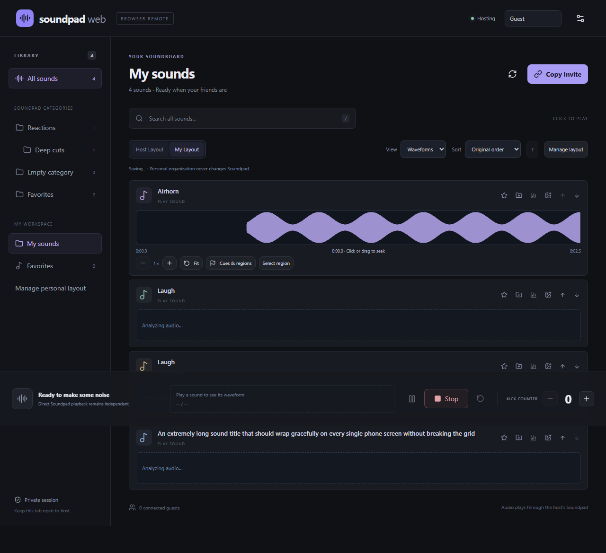

# Soundpad Web 2.2.1 history

For the 2.3 development update and its revised cleanup guarantees, see [2.3 notes](V2.3.md). The notes below describe earlier published versions.

V2 is published through the normal GitHub Pages site and the v2.2.1 Windows companion release. Existing users refresh the website and download the updated portable EXE. The original v1.0.0 release remains available for rollback. Basic V1 playback remains compatible; the website explains when an older companion needs updating for V2 features.

## 2.2.1 startup repair

Recovery cleanup now finishes before opening the host browser. This prevents a fast browser launch from opening a session that startup cleanup could then close. Existing host settings and managed permanent files are preserved.

## 2.2 session audio and precision update

- Waveforms cover the entire iconless play button. Pointer position picks the start; keyboard arrows select in 10 ms steps (Shift: one second), with Enter to commit. Artwork buttons remain full-surface play buttons.
- Footer zoom/pan/fit and a numeric seek field support millisecond selection. Soundpad's play-then-seek API still determines audible seek accuracy.
- Host analysis returns immediately with loading state, emits progressive peaks, and broadcasts ready results to requesting guests. One deduplicated native worker does the decoding; guests never decode host files. Final summaries use 512/4,096/32,768 bins (~146 KiB in browser peak arrays); requested results stay cached for the session.
- New invitations carry a 128-bit session seed plus a 128-bit hash of the host public key in a 44-character token. The room/password are domain-separated SHA-256 derivations. The signed welcome supplies the public key, which must match the pinned fingerprint before signature verification. Legacy full-key invitations still work. Existing legacy sessions can use a 97-character compact token without rotating the room.
- Spotify metadata, artwork and transports are available to guests when the host opts in; guest transport permission is independently enforced by the companion. Spotify enable/disable remains host-only.
- Personal organization (folders, order, favorites, hidden sounds) automatically publishes after edits, using host-bound peer ownership, validation and a 4 MiB aggregate limit. Others can explicitly copy a named layout. Cues, regions, zoom and view preferences stay personal.
- Session audio uses a separate, bounded encrypted WebRTC binary request, followed by an exact-origin authenticated loopback POST. Audio is decoded to app-owned PCM WAVs. Upload limit: 16 MiB; decoded limit: ten minutes / 64 MiB; session limit: 32 temporary files / 256 MiB.
- Uploads and reversed copies are imported into Soundpad's **temp** category and use normal mic playback. Reverse generates a frame-reversed copy and plays it automatically; the original is untouched. Cached reverse copies avoid repeated imports.
- Only the host can accept a managed upload permanently. Accepted files remain in Soundpad and are excluded from cleanup; they stay in temp until reorganized in Soundpad. Unaccepted files are cleaned on End hosting, normal companion shutdown, or recovery after restart/reconnect. An atomic app-owned journal records exact managed paths. Native cleanup discovers the built-in All category by type, revalidates each managed path/index, removes metadata with `DoRemoveSelectedEntries(false)`, verifies removal, then deletes only its GUID file. A failure preserves recovery information; the existing temp category and unrelated entries are retained. Native selection APIs are not transactional against simultaneous manual Soundpad editing.

The following 2.1 notes and earlier measurements are historical; current validation is recorded in the 2.2 verification section below.

## 2.1 fixes and interface update

Rapid seek requests are coalesced and rate-limited on the client. Accepted native seeks get a bounded 1.5-second transition window for lagging positions/transient stop samples while duration changes and explicit Stop still invalidate identity. A short legitimate guest burst receives backpressure rather than an immediate revocation; sustained floods still disconnect and execution remains limited. The player retains the last selected waveform with an honest label and disabled seek controls when playback identity becomes unknown.

Browser waveforms no longer expire after 30 seconds, evict after 64 entries, or disappear when a row scrolls out of view. Each requested waveform is shared for the tab session using Int16Array peaks. Only visible/visited sounds are loaded, with bounded concurrency and no eager whole-library decoding. Refresh, Retry, or reloading the tab explicitly invalidates the browser cache. The native disk cache still validates source-file identity/size/modification time on a new request. Memory grows with the number of visited sounds (about 43 KiB of peak arrays per full-length cached waveform), matching the requested session retention.

Icon-view artwork covers the play surface; iconless buttons render small genuine waveforms. The optional Spotify player sits above Library, keeps title/artist/artwork together, and filters exact supported Spotify application IDs without falling back to another application's media session. Only one Spotify request runs at a time. Bounded thumbnail reads are re-encoded to 128-pixel PNGs and cached per track. Read-only inspection confirmed the actual Spotify.exe source and artwork on this computer; transport controls were not exercised against the active session.

First invitation opening asks for a gamer name before pairing. The dialog has only Done and Random buttons. Random combinations are generated locally, without a third-party name service or extra network dependency. Name confirmation is remembered in local browser storage. The AI disclosure is small bottom-of-page text; the README also contains the requested made by AI warning.

## Implemented features

| Area | Behavior |
| --- | --- |
| Five views | Icons, Large Icons, List, sortable Details, and Waveforms; browser-personal view and sort settings |
| Waveforms | Actual decoded audio, not illustrations; stereo-safe min/max summaries at 512/4,096/32,768 bins, with source-derived duration and normalization |
| Analysis | One background worker, current-sound priority, deduplicated requests, 16 pending jobs; no playback/capture/output devices are opened |
| Cache | Source identity, size, modification time and algorithm version key a compressed native cache; corrupt entries rebuild; 64 MiB / 2,048-file budget; browser caches every requested waveform for the tab session using shared 16-bit peak arrays, without TTL/LRU eviction; Refresh or Retry explicitly invalidates data |
| Player | Artwork, web-requested identity and requester, status, interpolated playhead, time/duration, pause/resume, Stop, seek and last-cue replay; expandable phone player |
| Playback safety | Native absolute seek, duration clamping, current-sound epoch validation, deduplication and separate host-enforced guest seeking permission |
| Cues | Browser-personal named markers, pointer dragging, numeric editing, rename, delete and play |
| Regions | Drag selection or numeric bounds, names, edit/delete, per-region repeat and host-enforced boundary stop/repeat |
| Zoom | 1–32× detail, pan slider, fit; keyboard seek selection and commit |
| Personal layout | IndexedDB workspaces keyed by an opaque stable host identity; nested/reparentable/reorderable categories, multiple memberships, favorites, hiding and sound ordering |
| Layout interchange | Versioned JSON export/import; cycle validation, host matching, deduplicated memberships, and retained missing references; no invitations or signing keys in exports |
| Display names | Stable browser-local participant IDs and editable names forwarded through the authenticated host; display names are not authorization identities |
| Web statistics | Durable successful-start totals, last play, named participant counts and recent activity; duplicate requests, seeks and boundary repeats do not increase starts; confirmation before clearing, independent of Kick count |
| Native statistics | Read-only exact opaque-hash mapping from vendor `stats.spl` plus direct soundlist entries; counts and date-only last-play data stay separate from web totals; ambiguity/unavailable data shows an em dash |
| Icon editor | PNG/JPEG photos up to 12 MiB and 40 MP / 12,000 pixels per side; square crop, drag/pinch/wheel zoom, accessible position sliders, reset, save/cancel/remove; errors retain the editor |
| Icon storage | Re-encoded 96×96 PNGs in `icons/`; atomic metadata; obsolete app-owned revisions pruned after commit; 1,024 custom-sound limit and 4 MiB shared image metadata budget |
| Spotify | Opt-in shared Windows SMTC adapter, Spotify-only session selection, title/artist/status/progress, capability-gated play/pause/previous/next; no OAuth, streaming, or audio routing |
| Hosting | Accurate connection states, End Hosting and Resume Hosting; new invitation on resume, same personal workspace; disconnect and invitation revocation remain distinct |
| V1 behavior | Nested native categories, correct global sound indexes, custom artwork sharing, persistent Kick counter, permissions, reconnect, independent hosts, portable EXE and existing security boundaries retained |

Audio analysis limits are 512 MiB, 30 minutes of audio, 16 channels, 8–384 kHz and a 30-second cooperative decode deadline. PCM WAV and Ogg Vorbis have direct readers; MP3 and other supported codecs use Windows Media Foundation, also used as a fallback for compressed WAV/other Ogg variants. Missing/unsupported files produce an unavailable explanation and retain normal Soundpad playback. A blocked third-party codec cannot always be interrupted inside its own synchronous read; decoding remains isolated from command processing.

Native metadata is sampled at 4 Hz during active playback, 2 Hz while paused and about 0.67 Hz while idle. Commands wake the poller and publish immediately. Modern loopback/WebRTC clients receive lightweight playback ticks between full library changes; legacy clients still receive complete snapshots. Animation uses the browser's monotonic clock and requestAnimationFrame, with a reduced-motion cadence. A position revision distinguishes an intentional short backwards seek from sampling jitter.

Statistics retain at most 100 recent events, 50,000 sound aggregates and 32 named participant buckets per sound plus an Other bucket. Historical totals are never accepted from guests. Settings/statistics use the existing atomic local JSON store; ordinary native category membership is not changed; 2.2 adds the explicitly managed temp imports described above.

## Verification and performance

See the final session results below and [the V1 verification record](VERIFICATION.md) for the preceding deployed baseline. Tests use an isolated native pipe, temporary state and generated WAV data. No actual Soundpad playback, recording, device changes, app shutdown, or Spotify transport action was performed.

- Frontend: 35 Vitest tests; lint, TypeScript and production build pass; npm audit reports no vulnerabilities.
- Native: 40 tests pass, including V1 migration, durable deduplication/statistics, exact native-stat mappings, epoch rejection, region stop/repeat, generated MP3 decoding, real WAV peak geometry, cache corruption recovery, modern lightweight ticks, legacy loopback behavior, concurrent guest seeks versus replacement playback, and migration write failure recovery.
- Chromium: 18 passed, including public-relay two-guest scenarios and V2 workflows; one deployed-Pages check skipped. The deployed-Pages scenario is intentionally excluded because V2 has not been deployed. Detailed results are packaged in `artifacts/v2/test-results`.
- Phone/tablet widths are browser emulation, not physical-device acceptance.
- Read-only local decoding of actual WAV, MP3 and OGG files succeeded. Their names, paths and audio were not exported. Actual Spotify session detection succeeded and reported toggle/next/previous capabilities. Spotify controls themselves remain untested to preserve active listening.
- Firefox's installed test browser failed to launch (`spawn UNKNOWN`), so no Firefox behavior is claimed. Windows WebKit passed five baseline HTTP fixture checks and all five V2 workflow checks; its synthetic HTTPS-to-loopback hosting check did not connect. Chrome/Edge remain the recommended host browsers. This does not establish physical iOS/Safari guest acceptance.

One measured Chromium run with a 10,000-sound synthetic native catalog loaded in 910 ms and searched for the final item in 360 ms. Rendering stayed at 120 grid rows or 24 waveform rows until Load more. Native mock-pipe play acknowledgement took 211 ms including a full library revalidation; five seek acknowledgements were approximately 47 to 64 ms. These are local fixture results, not internet latency or audible Soundpad timings. The test emits fresh machine-readable measurements for subsequent runs.

Read-only cold/cache analysis on this PC:

| Source format | Decoded duration | Cold analysis | Disk cache | Decode count after both requests |
| --- | ---: | ---: | ---: | ---: |
| WAV | 10.000 s | 123 ms | 21 ms | 1 |
| MP3 | 1.837 s | 171 ms | 23 ms | 1 |
| OGG Vorbis | 5.272 s | 255 ms | 24 ms | 1 |

A separate 10,000-sound run measured about 45 MB of used browser JavaScript heap and 92 MB allocated, using Chromium's approximate `performance.memory` API. This is JavaScript heap, not the total browser-process memory footprint.

The packaged EXE was also measured without a host browser or guests against a four-sound mock pipe, using its actual idle/playing poll cadence. Eight-second samples reported 114 MiB working set / 54 MiB private memory idle and 119 MiB / 58 MiB during simulated playback; CPU was 1.17% and 2.34% of one core respectively. These short samples include runtime activity and are approximate, not real-audio or many-guest stress measurements. Run `scripts/benchmark-native.ps1` to repeat safely with isolated state; it records the executable hash and never uses the real Soundpad pipe. The large-library browser test emits its own heap and latency measurements.

Production JavaScript is approximately 469 kB / 145 kB gzip; CSS is 28 kB / 6.9 kB gzip. The native decoding dependencies are NAudio.Wasapi/Core 3.3.0 and NVorbis 0.10.5; dependency notices, CsWinRT and Windows SDK terms are embedded with the existing runtime notices. The main audio analysis memory footprint is bounded by streaming buffers and at most 16,384 envelope blocks, rather than decoded song length.

## Upgrade from V1

The website updates through GitHub Pages. An already running portable EXE does not update itself: close the old companion at a convenient time, then download and run the latest EXE from Releases. Existing settings migrate in the same app-data directory. No running companion or Soundpad instance is automatically stopped by deployment.

To upgrade safely:

1. At a convenient time, close the old companion. Keep Soundpad and its audio configuration as they are.
2. Preserve a copy of `%LOCALAPPDATA%\SoundpadWeb` as a rollback checkpoint, then replace only the app EXE and use the same app-data directory. The matching static V2 site is published through the normal Pages workflow.
3. On its first V2 load, the companion saves original `state.json` bytes as `state.v1.backup.json` before migration. It extracts valid embedded icons into `icons/`, commits schema 2 atomically and preserves the identity key, Kick count, permissions, saved website and deduplication receipts. Invalid legacy icon data stays recoverable in both the backup and legacy field; unreadable settings stop startup rather than resetting data.
4. Verify Kick count, permissions, artwork and normal playback in the approved environment. Browser personal metadata is separate IndexedDB data scoped to that browser/site and stable native host identity; export it before clearing site data.

Rollback: stop V2, retain its data directory for recovery, restore the V1 checkpoint (or original `state.v1.backup.json` as `state.json`) and V1 EXE/site. V1 cannot display icons that exist only in schema-2 `IconFiles`; restoring original V1 metadata is necessary. Changes made after that checkpoint, including later counters/statistics, are not automatically merged backwards.

Neither migration nor this implementation writes `%APPDATA%\Leppsoft`, Soundpad soundlists/statistics, audio devices, games, Discord settings or Soundpad's configuration. The real V1 app-data directory was not migrated during development.

## Vendor and acceptance limits

- The documented RC API has no current-sound identity getter or atomic play-at-offset command. Web starts are tracked; contradictory native samples clear identity. Manual replacement by another same-duration sound can remain indistinguishable. Unknown native playback is displayed without guessing a title.
- Starting a cue/region uses play then absolute seek. An opening fragment can be audible. Boundary stop/repeat is best effort at the active polling cadence plus pipe/queue latency, not sample accurate. A native stop or a missed natural end cancels the tracked region; repeats at the physical end of a file are not guaranteed.
- Native statistics reflect the last vendor-persisted XML snapshot, so they may lag a running Soundpad session. Only exact unique hashes are used. Unsupported, malformed, inaccessible or ambiguous entries remain unavailable. Date-only vendor values are not presented as exact timestamps.
- Names can be changed or duplicated; permission checks rely on the authenticated host/session and fixed guest role. Browser-personal storage can be unavailable or cleared; failures are visible and exports are available.
- Public signaling and NAT restrictions remain best effort; there is no universal free TURN guarantee.
- Real audible seeking/region boundaries, physical mobile-device interactions, Spotify transport buttons and production Pages V2 integration still require acceptance after the owner elects to test/deploy. None is implied by build success.

V2 was approved for normal publication, with these limits disclosed. It is not a claim that disruptive live acceptance checks have already been performed.

## Candidate artifacts and screenshots

Local candidate outputs are `artifacts/v2/SoundpadWeb.exe`, `SHA256.txt`, `SoundpadWeb-static.zip`, `SoundpadWeb-source.zip`, metrics and test reports. CI also publishes its portable EXE/static-site/browser-evidence artifacts. Generated binaries are not committed to Git.

All screenshots below show the isolated fixture app and generated audio, not the owner's sound library:

[Phone waveform view](screenshots/v2-waveforms-phone.png) · [Photo crop editor](screenshots/v2-crop.png)

## 2.1 fixture screenshots

[Artwork buttons](screenshots/artwork-buttons.png) - [Dedicated Spotify player with fixture metadata](screenshots/spotify-sidebar.png) - [First-invite gamer name](screenshots/gamer-name.png)

## 2.2 verification

The coordinated 2.2 development pass passed 38 frontend unit tests, 47 native tests, lint, TypeScript, the static production build, and npm audit (zero vulnerabilities). Chromium passed 21 browser scenarios including actual public Nostr/WebRTC pairing with two guests, compact host-pinned invitations, guest uploads and upload acknowledgement, guest organization sharing/copying, shared waveform delivery, permission changes and invitation revocation; the separate deployed-site check runs after publication. Four targeted Windows WebKit scenarios passed (first-join name, Spotify fixture UI, session upload/reverse/keep/cleanup, full-button scrubbing and footer precision at desktop/phone widths).

Audio/lifecycle tests use an isolated mock Soundpad pipe, generated stereo WAVs and temporary state. They check original-byte preservation, frame/channel order, normal native play commands, temp-category membership, host-only permanent approval, stale-session upload rejection, managed-only cleanup, recovery-journal cleanup, preservation of unrelated temp membership, and exact-origin/token protection. The 10,000-sound rendering/search regression also passed.

These checks do not establish actual Soundpad import/removal, audible mic playback, physical phone/iPad behavior or live Spotify transport acceptance. The user's active Soundpad library, audio routing and listening session were not mutated by these automated checks. Existing read-only native metadata and Spotify-source observations are described above.
